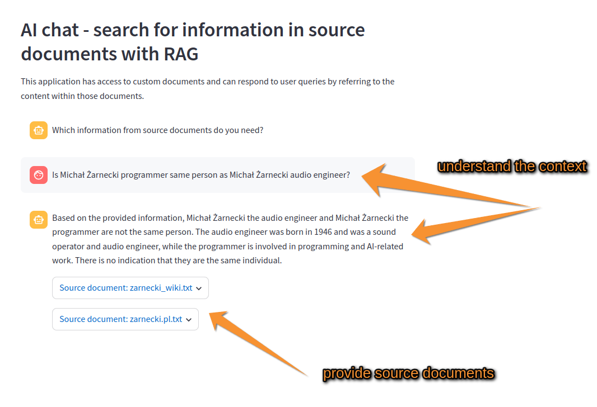

# chatbot based on language model with access to source documents

LLM (Large Language Model) based chatbot using RAG (Retrieval-augmented generation) and LangChain.
The chatbot answers questions using the text documents in the `data/` directory (sample website texts) and shows which source documents the answer came from.



## How it works
- documents from `data/*.txt` are split into chunks and embedded with OpenAI `text-embedding-3-small` into an in-memory vector store, once per server start
- for each question the 4 most similar chunks are retrieved and passed to the LLM together with the chat history
- the answer is streamed to the UI, with the source chunks shown in popovers below it

## Usage
1. create and activate a conda environment (Python 3.13), or reuse the course environment:
```bash
conda create -n llm-streamlit-rag python=3.13 -y
conda activate llm-streamlit-rag
```

2. install the needed libraries from this directory:
```bash
pip install -r requirements.txt
```

3. create a `.env` file with your OpenAI key, in this directory or in the repository root (both are found):
```
OPENAI_API_KEY="your_token_from_openai"
```
A key already exported in your shell takes precedence over `.env`; run `unset OPENAI_API_KEY` if it is outdated.

4. run the app from this directory (it reads documents from `data/` relative to the current directory) and open http://localhost:8501:
```bash
streamlit run index.py
```

5. run the tests:
```bash
pytest tests
```

To use it for your own purpose, replace the source documents in the `data/` directory with your own `.txt` files.
The prompt in [chat_prompt.py](lib/chat_prompt.py) can also be modified to fit your needs.

`index_streamlit_introduction.py` is a minimal Streamlit chat without an LLM, for learning the chat components (`streamlit run index_streamlit_introduction.py`).

This project was originally based on https://github.com/shashankdeshpande/langchain-chatbot
